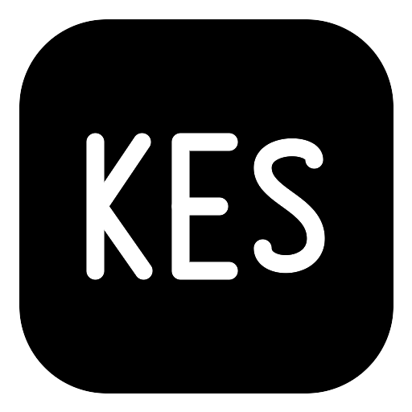

<p align="center">
  
</p>

<h1 align="center">Kestral</h1>

<p align="center">
  A fast, minimal, general-purpose CLI programming language implemented in zero-dependency C++20 (<code>.kes</code>).<br/>
  Includes the built-in <strong><code>nana</code></strong> TUI editor and <strong><code>kestral learn</code></strong> interactive terminal course.
</p>

```kes
fn greet(name = "friend") => "Hello, {name}!"

for person in ["Ada", "Grace", "Linus"] {
  say greet(person)
}
```

> **Note:** Looking for the browser-based Web Studio? It lives separately at **[AchillesOrg/Kestral-Studio](https://github.com/AchillesOrg/Kestral-Studio)**. This repository focuses purely on the native `kestral` CLI runtime, compiler-grade test suite, `nana` TUI editor, and interactive CLI curriculum.

## Install

**macOS & Linux:**
```sh
curl -fsSL https://raw.githubusercontent.com/AchillesOrg/Kestral/main/install.sh | sh
```

**Windows (PowerShell):**
```powershell
irm https://raw.githubusercontent.com/AchillesOrg/Kestral/main/install.ps1 | iex
```

**Build from Source (C++20):**
```sh
git clone https://github.com/AchillesOrg/Kestral.git
cd Kestral
make
make test
make install
```

Or with CMake:
```sh
cmake -B build -DCMAKE_BUILD_TYPE=Release
cmake --build build --config Release
ctest --test-dir build --output-on-failure
```

## CLI Usage

```sh
kestral                         # interactive multiline REPL
kestral examples/primes.kes     # run a .kes file
kestral -e 'say "hi".upper()'   # evaluate an inline snippet
kestral check script.kes        # check syntax without running
kestral nana [file.kes]         # open the minimalist nana TUI editor
kestral learn                   # start the 10-lesson interactive TUI course
kestral learn --list            # view curriculum and completion progress
kestral banner                  # print the Kestral startup card
```

Pass `--bg mica` (default transparent terminal surface) or `--bg black` (minimal `#000000` black surface) to `kestral nana` or `kestral learn`, or press `t` inside any menu to switch live.

## Built-in `nana` TUI Editor

- Live `.kes` syntax highlighting (`//` comments, `{expr}` string interpolation, keywords, `|>`, `=>`, `??`, built-ins)
- Starter templates with live preview, `.kes` file browser, smart auto-indent after `{`, and live syntax validation
- **Adaptive & Minimalist**: hairline chrome (zero full-width solid bars), explicit cursor row positioning with `SIGWINCH` live resize, and selectable **Mica (transparent)** or **Pure Black (`#000000`)** surface
- Shortcuts: `Ctrl+S` Save · `Ctrl+R` Run · `Ctrl+P` Menu · `Ctrl+K` Cut · `Ctrl+U` Paste · `Ctrl+G` Help · `Ctrl+X` Exit

## Interactive Course (`kestral learn`)

10 progressive CLI-first lessons inside an adaptive split-pane terminal IDE (Brief & Tests left, `nana` editor right) culminating in **Lesson 10 — Capstone: Number Cruncher**:

1. Hello & Text Cards · 2. Functions & Defaults · 3. If Expressions & Match · 4. Loops, Ranges & Methods · 5. Lists, Maps & Word Counts · 6. Closures & State · 7. CLI Arguments & Boxed Output · 8. Files & Error Recovery · 9. Interactive Input Loops · 10. **Capstone: Number Cruncher**

## Documentation

- [Tutorial (`TUTORIAL.md`)](TUTORIAL.md) — Complete 10-lesson CLI walkthrough
- [Language Guide (`docs/language.md`)](docs/language.md) — Syntax, expressions, closures, `match`, `use`
- [Built-ins Reference (`docs/builtins.md`)](docs/builtins.md) — All 45+ built-in functions
- [CLI & `nana` TUI (`docs/cli-and-nana.md`)](docs/cli-and-nana.md) — Commands, REPL, `nana`, and `kestral learn`

## License

MIT
